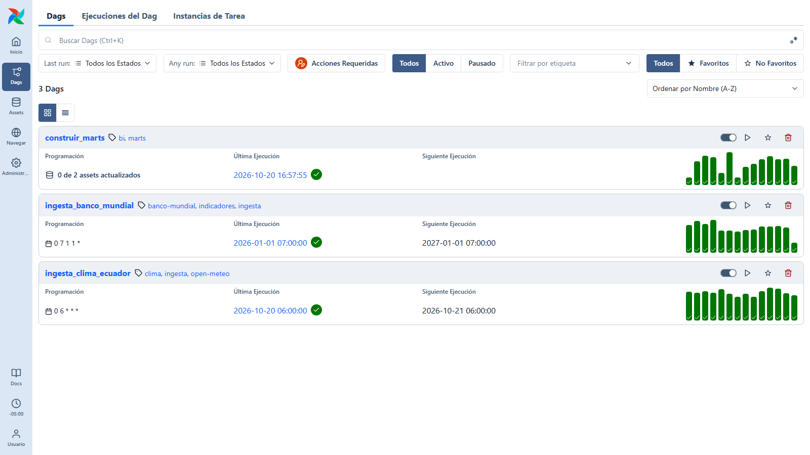

🇺🇸 **English (summary)** · 🇪🇸 [Español (full version)](README.es.md)

# Daily ingestion of public APIs with Apache Airflow · Ecuador's climate + World Bank

Orchestration with **Apache Airflow 3.3** on Docker Compose: three DAGs bring the daily weather of **13 Ecuadorian cities**
(Open-Meteo) and **10 World Bank indicators** for Ecuador and 7 countries of the region, and load them into Postgres in
layers: **raw (JSON as received) → staging (typed) → marts (ready for Power BI)**. Real backfill of **384 days** and
**26 years** (2000–2025), with quality checks that stop the DAG when the data are wrong.

| | |
|---|---|
| **Orchestrator** | Airflow 3.3.2 (official image), LocalExecutor, memory limited per service (≈ 5.3 GB in total) |
| **DAGs** | `ingesta_clima_ecuador` (daily) · `ingesta_banco_mundial` (yearly) · `construir_marts` (asset-driven) |
| **Backfill** | `catchup=True`: 384 daily + 26 yearly runs, **all green** |
| **Loaded** | 4,992 weather rows · 2,234 World Bank values · 7 mart tables |
| **Quality** | 9 checks per day, 16 per year and 7 reconciliation checks before publishing: **6,405 logged evaluations** |
| **Resilience** | Two levels of retries, pool + limiter for the API quota, idempotent re-runs |
| **Tests** | 55 tests (DAG integrity, pure logic, SQL against a real Postgres) + CI in GitHub Actions |
| **Cloud** | How to take it to MWAA / Cloud Composer (not deployed); estimated cost: MWAA ≈ 405 USD/month vs. ≈ 15–50 USD/month with Lambda |

## What each DAG demonstrates

| DAG | One run = | What it demonstrates |
|---|---|---|
| `ingesta_clima_ecuador` | one day (Ecuador time) | backfill by date, idempotency, pool and quota limiter, archive/forecast choice |
| `ingesta_banco_mundial` | one year | reschedule sensors, dynamic task mapping (×10), controlled parallelism, API pagination |
| `construir_marts` | every new asset event | data-driven dependencies between DAGs, write-audit-publish in one transaction, reconciliation |

## Highlights

- **Pace:** 5.2 days per minute at steady state; 78 minutes of effective work. The ceiling is Open-Meteo's free quota, not
  Airflow.
- **The computer shut down twice during the backfill.** Runs caught halfway exceeded their `dagrun_timeout` and failed; a
  *Clear* re-ran them, and since every day is idempotent the result was complete.

**Architecture, design decisions, reproduction commands and cost estimate:** [full README (Spanish)](README.es.md) ·
[step-by-step guide (Spanish)](docs/GUIA_PASO_A_PASO.md). Commands are language-independent.
