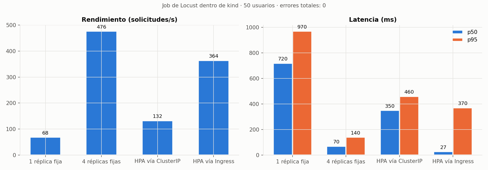
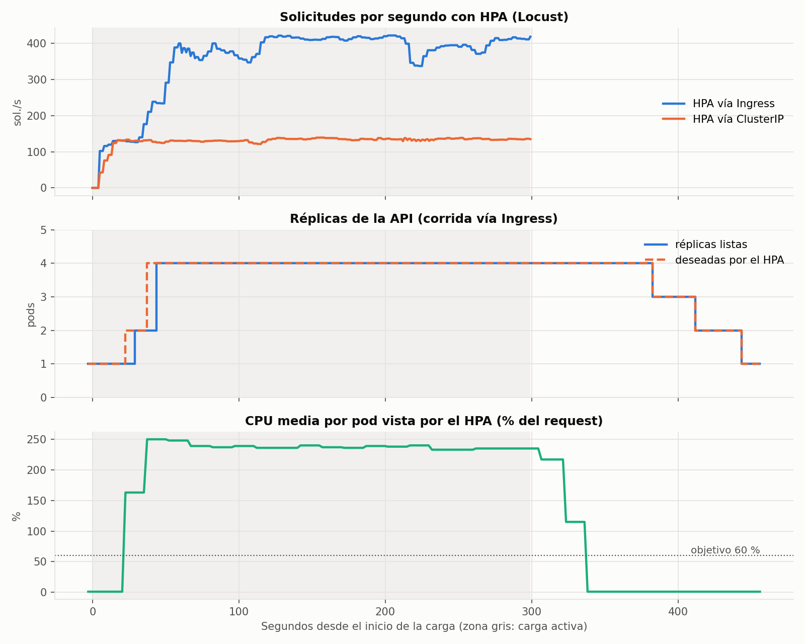

🇺🇸 **English (summary)** · 🇪🇸 [Español (full version)](README.es.md)

# ☁️ Ecuador climate API on Kubernetes · FastAPI, Helm and observability

A FastAPI API and a Streamlit app to query **4,392 daily weather observations** from **12 Ecuadorian cities** during 2024,
deployed on a local **kind** cluster with Helm, Ingress, HPA, metrics-server, Prometheus and Grafana. Everything below was
really run on Docker Desktop; the figures come from `reports/` and no cloud infrastructure is created.

## Horizontal scaling: 1 replica vs. 4 and HPA

A **Locust Job inside the cluster** with 50 concurrent users. Each API pod requests 200m and is limited to 500m of CPU.

| Scenario | Duration | Requests | Errors | Requests/s | p50 | p95 | p99 |
|---|---:|---:|---:|---:|---:|---:|---:|
| 1 fixed replica | 120 s | 8,237 | 0 | 68.5 | 720 ms | 970 ms | 1,100 ms |
| 4 fixed replicas | 120 s | 57,172 | 0 | 476.3 | 70 ms | 140 ms | 160 ms |
| HPA 1→4, traffic to the Service (ClusterIP) | 300 s | 39,658 | 0 | 132.2 | 350 ms | 460 ms | 500 ms |
| HPA 1→4, traffic through ingress-nginx | 300 s | 109,115 | 0 | 363.7 | 27 ms | 370 ms | 460 ms |

- With 4 fixed replicas, throughput is 7 times that of a single one.
- **Finding:** with the HPA and traffic sent straight to the Service, the cluster reached 4 replicas but throughput barely
  changed. kube-proxy balances per **connection**, and the keep-alive users had opened all their connections when only one
  pod existed: one pod at 0.5 cores and three almost idle.
- Through **ingress-nginx**, which balances every request, the four pods worked and steady-state throughput rose to ~400
  requests/s.
- **Scaling time:** first decision after ~23 s, 4 replicas ready after ~44 s, no scale-down during the load.
- **Zero-downtime upgrade and rollback:** `helm upgrade` and `helm rollback` were run during a load test, with
  `maxUnavailable: 0`, checking the served version at every step.

**Architecture, decisions, limitations, reproduction commands and the path to EKS, GKE or AKS:**
[full README (Spanish)](README.es.md). Commands are language-independent.
