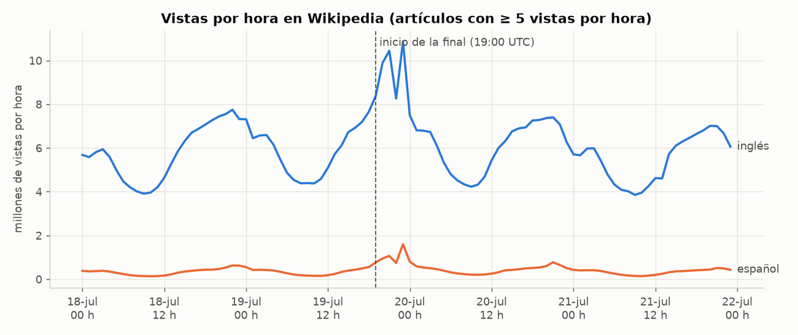

🇪🇸 [Español (full version)](README.md) · 🇬🇧 **English (summary)**

# 🧊 Local lakehouse with Apache Iceberg + Trino + Nessie on Wikipedia pageviews

A complete lakehouse on Docker Compose: **MinIO** as S3, **Nessie** as an Iceberg REST catalog with git-like branches,
**Trino** as the SQL engine and a **Python loader (PyIceberg)**. It ingests **96 hourly dumps** of Wikipedia pageviews
(18–21 July 2026, around the **World Cup final**), filters them to Spanish and English and organizes them in raw → clean →
aggregate layers. On top of it, what makes Iceberg special is demonstrated with evidence.

**Business problem.** A content team wants to know, hour by hour, which articles are trending in each language. It needs an
open store, cheap to query, where a badly loaded day **never** reaches the dashboards and where yesterday's state can be
recovered.

## Results (real run, 27 Oct 2026)

| | |
|---|---|
| **Data** | 96 hourly files, **5,247 MB** downloaded (594.8M lines) → **30.7M rows** with ≥ 5 views per hour, **262 MB** filtered (20× less) |
| **Layers** | raw **30,677,014** rows · clean **30,432,442** rows (614.3M views) · 6 aggregate tables |
| **Time travel** | Nessie tag at the 18 July 23:00 commit: **7,618,728** rows, vs. **15,263,513** in `main` at that moment |
| **Schema** | `ADD COLUMN` in **0.12 s**: 96 files and 161.0 MB **identical** before and after (no file rewritten) |
| **Partitions** | from daily to hourly without rewriting: both specs coexist and the 2 old queries return **exactly** the same result |
| **Compaction** | raw: **72 → 3 files** in 21.8 s; MinIO 306 MB → 525 MB after `optimize` → **219 MB** after `nessie-gc` |
| **Branches (WAP)** | day with defects: **3 of 7 checks fail** and `main` does not change · correct day: **7/7**, merged in **0.07 s** |
| **Pruning** | one hour in Spanish: **0.28 MB and 75 ms** with pruning vs. **323.7 MB and 850 ms** without (median of 5) |
| **Tests** | 32 pytest without containers + 1 integration test (branch → merge → Trino) · ruff · Terraform `fmt`/`validate` |
| **Cloud** | `terraform/aws`: S3 + Glue Data Catalog (Iceberg) + Athena · never applied · **~7 USD/month** with 1 year of data (assumptions in the full README) |

> **Wikimedia regenerated these dumps after this run**, and they are now smaller. A run on 8 Nov 2026 stored 30.3M rows
> (vs. 30.7M). The conclusions do not change, but exact figures may differ by a few percentage points when reproducing it.

**Architecture, evidence, business analysis, limitations and reproduction commands:**
[full README (Spanish)](README.md). Commands are language-independent.
