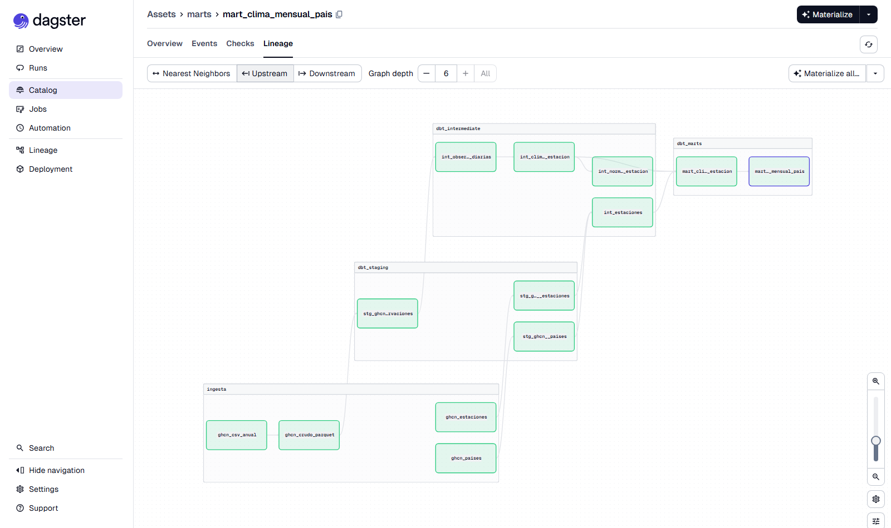
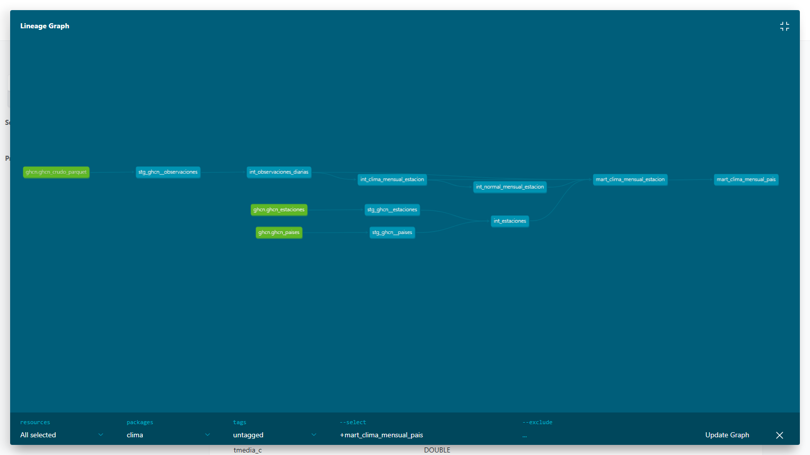

🇪🇸 [Español (full version)](README.md) · 🇬🇧 **English (summary)**

# 🌦️ Local modern data stack: Dagster + dbt + DuckDB + MinIO on NOAA GHCN-Daily

An **asset-based** pipeline that ingests **177.5 million daily observations** from ~45,000 weather stations worldwide (NOAA
GHCN-Daily, **2022–2026**, 6.4 GB of CSV), stores them in an S3-like lake (MinIO, Parquet) and transforms them with **dbt**
into a **DuckDB** warehouse, publishing monthly climate indicators by station and country, anomalies against a normal and
extremes, with **45 quality checks** and end-to-end lineage. It includes reference Terraform for GCP (`fmt` and `validate`
only).

**Business problem.** A weather service needs a maintainable pipeline that brings in new data every day, discards values that
fail NOAA's checks and publishes reliable indicators: with tests that stop publication if something is wrong, lineage to know
where each number comes from, and the ability to reprocess any year without touching the others.

| | |
|---|---|
| **Orchestration** | Dagster 1.13 (webserver + daemon) on Docker Compose · 4 Python assets + 10 dbt models as assets |
| **Real backfill** | 5 yearly partitions (2022–2026), **5/5 green**, 6.1 min of runs in total (74 s per year on average) |
| **Storage** | CSV 6,388 MB → `.csv.gz` 813 MB → **Parquet 171 MB** in MinIO (37× less than the CSV) |
| **Transformation** | dbt build: **10 models + 37 tests passing and 2 warnings** in 150 s over 94M rows |
| **Quality** | 5 blocking asset checks per year + 39 dbt tests + 1 business check + source freshness |
| **Tests** | 16 pytest (resumable download, conversion, checks, Dagster without network) + dbt build on a sample in CI |
| **Cloud** | `terraform/gcp`: GCS + BigQuery + Cloud Run job + Cloud Scheduler · `fmt` and `validate` OK, never applied |
| **Memory** | ≤ 7.5 GB in total; measured daemon peak: 3.5 GB |

**Architecture, per-year backfill, decisions, limitations, reproduction commands and cost estimate:**
[full README (Spanish)](README.md). Commands are language-independent.
