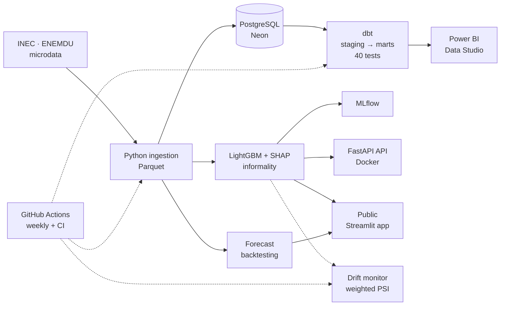

🇪🇸 [Español](README.md) · 🇬🇧 **English**

# 📊 Ecuador Labor Observatory · ENEMDU → dbt → ML → Power BI

[](https://github.com/GUAR-NIX/PORTAFOLIO-CLOUD/actions/workflows/observatorio-laboral-ec.yml)
[](https://github.com/GUAR-NIX/PORTAFOLIO-CLOUD/actions/workflows/observatorio-laboral-ec-pipeline.yml)
[](https://github.com/GUAR-NIX/PORTAFOLIO-CLOUD/actions/workflows/observatorio-laboral-ec-modelo.yml)

From the **microdata of Ecuador's national employment survey (ENEMDU, by INEC, the national statistics institute)** to a
**model in production** and a **public dashboard**: automated ingestion, a data warehouse with dbt on PostgreSQL, official
indicators reproduced with survey expansion factors, explainable machine learning models, an API, a web app and
monitoring. Zero cost, and everything measured.

> 🌐 This page is a full translation of the Spanish README. The linked documents are in Spanish.

## 🔗 Live

| | Link | What is there |
|---|---|---|
| 🧮 **App** | **[observatorio-laboral-ec.streamlit.app](https://observatorio-laboral-ec.streamlit.app/?lang=en)** | Informality simulator by profile, with an explanation of every prediction, and a 3-month forecast (English and Spanish) |
| 📈 **Dashboard** | **[Data Studio](https://datastudio.google.com/reporting/a932a4c2-ecc6-4148-afd1-df75157ebdb0)** | Monthly indicators with period, sex and area filters, read live from PostgreSQL (Spanish) |
| 📄 **Power BI** | [Screenshots and PDF](bi/README.md) | 4-page report: summary, gaps, territory and data quality (Spanish) |
| 📘 **Guide** | [Step by step](docs/GUIA_PASO_A_PASO.md) | Every phase with its decisions, mistakes and how they were solved (Spanish) |

## In numbers

| | |
|---|---|
| Data | 41 months of microdata · 1.16M person records · 559,089 employed-person records in the model |
| Quality | 20 out of 20 official INEC rates reproduced to one decimal (5 months) · 40 dbt tests · 50 Python tests |
| Model | AUC **0.910** on unseen months · estimated rate within 0.4 points of the observed one · AUC from 0.89 to 0.93 by sex and area |
| Forecast | Mean error of **0.24 points** for unemployment, 26% better than the baseline |
| Operations | Weekly pipeline · CI with a quality gate · Docker · drift monitor · 0 USD cost |

## Results

**The official INEC rates are reproduced from the microdata** (May 2026, 27,369 respondents representing 19.09 million
inhabitants), applying the official syntax and the expansion factor:

| Indicator | Calculated | INEC | Difference |
|---|---|---|---|
| Global participation rate | 65.90% | 65.9% | 0.00 |
| Adequate employment rate | 36.60% | 36.6% | 0.00 |
| Underemployment rate | 18.32% | 18.3% | +0.02 |
| Unemployment rate | 3.06% | 3.1% | −0.04 |

This is the foundation for everything else: if an indicator does not match the official one, nothing built on top of it
can be trusted.

**Automated time series:** ingestion downloads and processes **41 months** (January 2023 to May 2026) in 19 s; the second
run downloads nothing (idempotent, with a SHA-256 manifest). The **5 months** with a published official figure match on
all 4 rates when rounded to one decimal.

**In the cloud:** 1,158,484 rows loaded into PostgreSQL (Neon) with `COPY` in 71 s; the load is idempotent and verified
inside the database: 0 duplicates and the rates computed in SQL match INEC's (20 out of 20).

**Star schema with dbt:** staging → intermediate → marts, with an aggregated fact table of 73,630 rows (13 MB) and
**40/40 tests passing**, including one that compares the mart's rates with INEC's official ones. That test caught a real
double-rounding bug before it reached any dashboard.

**Automatic pipeline:** every Monday, GitHub Actions downloads the months INEC has published, loads them into Neon, runs
`dbt build` with its 40 tests, checks freshness and publishes a summary with the latest rates. First cloud run: **green in
1 min 43 s**. Calculation: [`indicadores.py`](src/observatorio/indicadores.py) · validation:
[`validar_tasas_oficiales.py`](scripts/validar_tasas_oficiales.py) · variables: [dictionary](docs/datos/diccionario.md).

**BI:** a 4-page Power BI report ([screenshots and PDF](bi/README.md)) and a
**[public live dashboard in Data Studio](https://datastudio.google.com/reporting/a932a4c2-ecc6-4148-afd1-df75157ebdb0)**,
both using a read-only database user.

**Machine learning · probability of informality:** LightGBM on 559,089 employed-person records (398,378 for training),
evaluated on 6 months it had never seen: **AUC 0.910** (logistic regression: 0.881) and **well calibrated**: for May 2026
it estimates 52.95% informality versus 52.84% observed in the microdata. With SHAP: industry and occupation matter more
than everything else, higher education is protective, and age is U-shaped. It does not perform worse for women or for
rural areas. → [Model card](reports/modelo_informalidad/README.md)

**Forecast with backtesting:** 12 rolling origins, never looking at the future. The 3-month mean wins (an error of **0.24
points** for unemployment, 26% better than repeating the last value); SARIMA, more complex, does worse. Since the model is
chosen and measured on the same backtest, the winner's error is somewhat optimistic. Forecast for June–August 2026:
**3.0% unemployment** (80% interval: 2.6–3.5). → [Results](reports/pronostico/README.md)

**MLOps:** the model is served by a **FastAPI API** that explains every prediction (the 3 factors that raise or lower the
probability the most), packaged in a minimal **Docker** image. A workflow retrains from INEC's data, applies a **quality
gate** (it fails if the model does not reach the minimum thresholds), and tests the API and the container; experiments are
logged in **MLflow**. → [API](api/README.md)

**Product and monitoring:** a **[public Streamlit app](https://observatorio-laboral-ec.streamlit.app/?lang=en)** with a
profile simulator and the forecast, and a weekly monitor of drift (weighted PSI) and performance: **no drift** in the 12
months after training and AUC between 0.90 and 0.92. → [Monitor](reports/monitoreo/README.md)

## Architecture



## Technical decisions

| ADR (Spanish) | Decision |
|---|---|
| [0001](docs/adr/ADR-0001-alcance-y-fuentes.md) | ENEMDU microdata with expansion factors; validate against INEC's official rates (< 0.1 points) |
| [0002](docs/adr/ADR-0002-nube-gratuita.md) | A genuinely free cloud: Neon (PostgreSQL), GitHub Actions, Streamlit Community Cloud, MLflow |
| [0003](docs/adr/ADR-0003-dbt-modelo-estrella.md) | dbt in three layers and a star schema |
| [0004](docs/adr/ADR-0004-bi-power-bi-y-looker.md) | Power BI (Ecuadorian market) + Data Studio, formerly Looker Studio (public link) |
| [0005](docs/adr/ADR-0005-modelo-informalidad.md) | Informality model: INEC's definitions, no income variable (leakage), temporal validation, expansion weights |
| [0006](docs/adr/ADR-0006-pronostico-desempleo.md) | Forecast: rolling-origin backtesting against naive baselines; empirical intervals |
| [0007](docs/adr/ADR-0007-mlops-api-docker.md) | MLOps: MLflow, FastAPI API in minimal Docker and a CI that retrains with a quality gate |
| [0008](docs/adr/ADR-0008-monitoreo-deriva.md) | Drift monitor: PSI weighted by the sampling design and calibration with a 3-month moving average |

## How to reproduce it

```bash
cd observatorio-laboral-ec
python -m venv .venv && source .venv/bin/activate      # on Windows: .venv\Scripts\Activate.ps1
pip install -r requirements-dev.txt
cp .env.example .env                                   # and set the PostgreSQL connection
pytest
export PYTHONPATH=src
python -m observatorio.ingesta --desde 2023-01 --hasta actual                   # microdata
pip install -r requirements-ml.txt && python scripts/entrenar_informalidad.py   # model, ~10 s
python scripts/pronosticar_indicadores.py                                       # forecast and backtesting
```

## Data source and license

Code under [MIT](LICENSE). Data: **INEC**, National Survey of Employment, Unemployment and Underemployment (ENEMDU). The
data keep their publisher's terms of use and are not redistributed in this repository: the project downloads them from the
official source. The model published in `app/modelo/` contains no microdata, only the trained trees.
