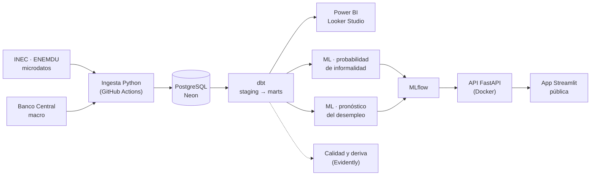

# 📊 Observatorio laboral del Ecuador · ENEMDU → dbt → ML → Power BI

De los **microdatos de la encuesta de empleo del INEC (ENEMDU)** a un **modelo en producción** y un **dashboard público**:
ingesta automatizada, data warehouse con dbt sobre PostgreSQL, indicadores oficiales reproducidos con factores de
expansión, modelos de machine learning explicables, API, app web y monitorización. Coste cero y todo medido.

> 🚧 **En construcción.** El estado de cada fase está abajo y el detalle, en la [guía paso a paso](docs/GUIA_PASO_A_PASO.md).

## Resultados hasta ahora

**Las tasas oficiales del INEC se reproducen desde los microdatos** (mayo de 2026, 27.369 personas encuestadas que
representan a 19,09 millones de habitantes), aplicando la sintaxis oficial y el factor de expansión:

| Indicador | Calculado | INEC | Diferencia |
|---|---|---|---|
| Tasa de participación global | 65,90 % | 65,9 % | 0,00 |
| Tasa de empleo adecuado | 36,60 % | 36,6 % | 0,00 |
| Tasa de subempleo | 18,32 % | 18,3 % | +0,02 |
| Tasa de desempleo | 3,06 % | 3,1 % | −0,04 |

Es la base de todo lo demás: si un indicador no coincide con el oficial, nada construido encima es fiable.

**Serie histórica automatizada:** la ingesta descarga y procesa **41 meses** (enero de 2023 a mayo de 2026) en 19 s;
la segunda ejecución no descarga nada (idempotente, con manifiesto SHA-256). Los **5 meses** con cifra oficial
publicada coinciden en las 4 tasas con diferencia 0,0.

**En la nube:** 1.158.484 filas cargadas en PostgreSQL (Neon) con `COPY` en 71 s, carga idempotente y verificada
dentro de la base: 0 duplicados y las tasas calculadas en SQL iguales a las del INEC (20 de 20).

**Modelo estrella con dbt:** staging → intermediate → marts, con un hecho agregado de 73.630 filas (13 MB) y
**40/40 tests en verde**, entre ellos uno que compara las tasas del mart con las oficiales del INEC. Ese test detectó
un error real de doble redondeo antes de que llegara a ningún dashboard.

**Pipeline automático:** cada lunes, GitHub Actions descarga los meses que el INEC haya publicado, los carga en Neon,
ejecuta `dbt build` con los 40 tests, comprueba la frescura y publica un resumen con las últimas tasas. Primera
ejecución en la nube: **en verde en 1 min 43 s**.
Cálculo: [`indicadores.py`](src/observatorio/indicadores.py) · validación: [`validar_tasas_oficiales.py`](scripts/validar_tasas_oficiales.py) ·
variables: [diccionario](docs/datos/diccionario.md).

## Arquitectura



## Fases

| Fase | Contenido | Estado |
|---|---|---|
| 0 · Base | Estructura, decisiones de arquitectura, entorno, CI | ✅ |
| 1 · Comprensión de los datos | Fuentes, diccionario, factores de expansión, tasas oficiales reproducidas | ✅ |
| 2 · Ingesta | Descarga automática e idempotente de 41 meses; carga en PostgreSQL (Neon) | ✅ |
| 3 · Modelado (dbt) | staging → intermediate → marts (modelo estrella), 40 tests | ✅ |
| 4 · Calidad y orquestación | Pipeline semanal en GitHub Actions: ingesta → carga → dbt → frescura | ✅ |
| 5 · Análisis y BI | KPIs del mercado laboral en Power BI ([informe y capturas](bi/README.md)) y [tablero público en Data Studio](https://datastudio.google.com/reporting/a932a4c2-ecc6-4148-afd1-df75157ebdb0) | ✅ |
| 6 · ML: informalidad | Clasificación explicable (SHAP) con análisis de equidad | ⏳ |
| 7 · ML: pronóstico | Tasa de desempleo con *backtesting* | ⏳ |
| 8 · MLOps | MLflow, API en Docker, CI de modelos | ⏳ |
| 9 · Producto | App pública con simulador por perfil | ⏳ |
| 10 · Monitorización | Deriva de datos y del modelo | ⏳ |
| 11 · Publicación | Resultados, guía y vídeo | ⏳ |

## Decisiones técnicas

| ADR | Decisión |
|---|---|
| [0001](docs/adr/ADR-0001-alcance-y-fuentes.md) | Microdatos de la ENEMDU con factores de expansión; validar contra las tasas oficiales del INEC (< 0,1 puntos) |
| [0002](docs/adr/ADR-0002-nube-gratuita.md) | Nube gratuita real: Neon (PostgreSQL), GitHub Actions, Hugging Face / Streamlit, MLflow |
| [0003](docs/adr/ADR-0003-dbt-modelo-estrella.md) | dbt en tres capas y modelo estrella; BI y ML solo leen `marts` |
| [0004](docs/adr/ADR-0004-bi-power-bi-y-looker.md) | Power BI (mercado ecuatoriano) + Looker Studio (enlace público) |

## Cómo reproducirlo

```bash
cd observatorio-laboral-ec
python -m venv .venv && source .venv/bin/activate      # en Windows: .venv\Scripts\Activate.ps1
pip install -r requirements-dev.txt
cp .env.example .env                                   # y ajusta la conexión a PostgreSQL
pytest
```

## Estructura

```
src/observatorio/   Código Python (configuración, indicadores oficiales, ingesta…)
scripts/            Utilidades (validación contra las cifras oficiales del INEC)
dbt/                Transformaciones SQL y tests de datos
ml/  api/  app/     Modelos, API y aplicación web
monitoring/  bi/    Monitorización y tableros
notebooks/          Exploración
docs/               ADR, diccionario de datos y guía paso a paso
tests/              Tests de Python
```

## Fuente de datos y licencia

Código bajo [MIT](LICENSE). Datos: **INEC**, Encuesta Nacional de Empleo, Desempleo y Subempleo (ENEMDU), y **Banco
Central del Ecuador**. Conservan los términos de uso de sus publicadores y no se redistribuyen en este repositorio: el
proyecto los descarga desde la fuente oficial.
