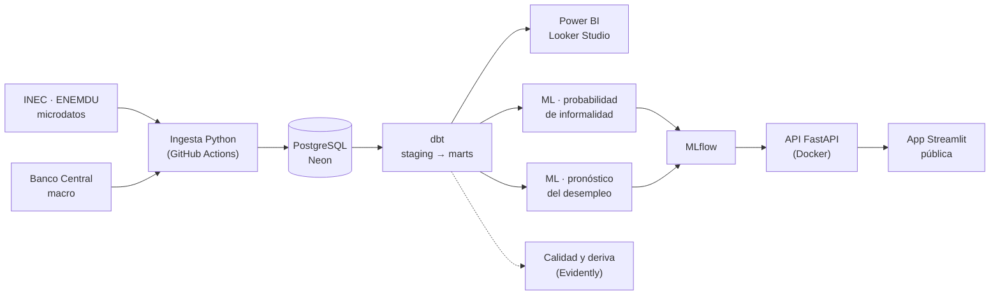

# 📊 Observatorio laboral del Ecuador · ENEMDU → dbt → ML → Power BI

De los **microdatos de la encuesta de empleo del INEC (ENEMDU)** a un **modelo en producción** y un **dashboard público**:
ingesta automatizada, data warehouse con dbt sobre PostgreSQL, indicadores oficiales reproducidos con factores de
expansión, modelos de machine learning explicables, API, app web y monitorización. Coste cero y todo medido.

> 🚧 **En construcción.** El estado de cada fase está abajo y el detalle, en la [guía paso a paso](docs/GUIA_PASO_A_PASO.md).

## Arquitectura



## Fases

| Fase | Contenido | Estado |
|---|---|---|
| 0 · Base | Estructura, decisiones de arquitectura, entorno, CI | ✅ |
| 1 · Comprensión de los datos | Fuentes, diccionario, EDA, factores de expansión, tasas oficiales reproducidas | 🔄 En curso |
| 2 · Ingesta | Descarga automática e idempotente | ⏳ |
| 3 · Modelado (dbt) | staging → intermediate → marts (modelo estrella) | ⏳ |
| 4 · Calidad y orquestación | Tests, frescura, alertas, pipeline programado | ⏳ |
| 5 · Análisis y BI | KPIs del mercado laboral en Power BI y Looker Studio | ⏳ |
| 6 · ML: informalidad | Clasificación explicable (SHAP) con análisis de equidad | ⏳ |
| 7 · ML: pronóstico | Tasa de desempleo con *backtesting* | ⏳ |
| 8 · MLOps | MLflow, API en Docker, CI de modelos | ⏳ |
| 9 · Producto | App pública con simulador por perfil | ⏳ |
| 10 · Monitorización | Deriva de datos y del modelo | ⏳ |
| 11 · Publicación | Resultados, guía y vídeo | ⏳ |

## Decisiones técnicas

| ADR | Decisión |
|---|---|
| [0001](docs/adr/ADR-0001-alcance-y-fuentes.md) | Microdatos de la ENEMDU con factores de expansión; validar contra las tasas oficiales del INEC (< 0,1 puntos) |
| [0002](docs/adr/ADR-0002-nube-gratuita.md) | Nube gratuita real: Neon (PostgreSQL), GitHub Actions, Hugging Face / Streamlit, MLflow |
| [0003](docs/adr/ADR-0003-dbt-modelo-estrella.md) | dbt en tres capas y modelo estrella; BI y ML solo leen `marts` |
| [0004](docs/adr/ADR-0004-bi-power-bi-y-looker.md) | Power BI (mercado ecuatoriano) + Looker Studio (enlace público) |

## Cómo reproducirlo

```bash
cd observatorio-laboral-ec
python -m venv .venv && source .venv/bin/activate      # en Windows: .venv\Scripts\Activate.ps1
pip install -r requirements-dev.txt
cp .env.example .env                                   # y ajusta la conexión a PostgreSQL
pytest
```

## Estructura

```
src/observatorio/   Código Python (configuración, ingesta…)
dbt/                Transformaciones SQL y tests de datos
ml/  api/  app/     Modelos, API y aplicación web
monitoring/  bi/    Monitorización y tableros
notebooks/          Exploración
docs/               ADR, diccionario de datos y guía paso a paso
tests/              Tests de Python
```

## Fuente de datos y licencia

Código bajo [MIT](LICENSE). Datos: **INEC**, Encuesta Nacional de Empleo, Desempleo y Subempleo (ENEMDU), y **Banco
Central del Ecuador**. Conservan los términos de uso de sus publicadores y no se redistribuyen en este repositorio: el
proyecto los descarga desde la fuente oficial.
