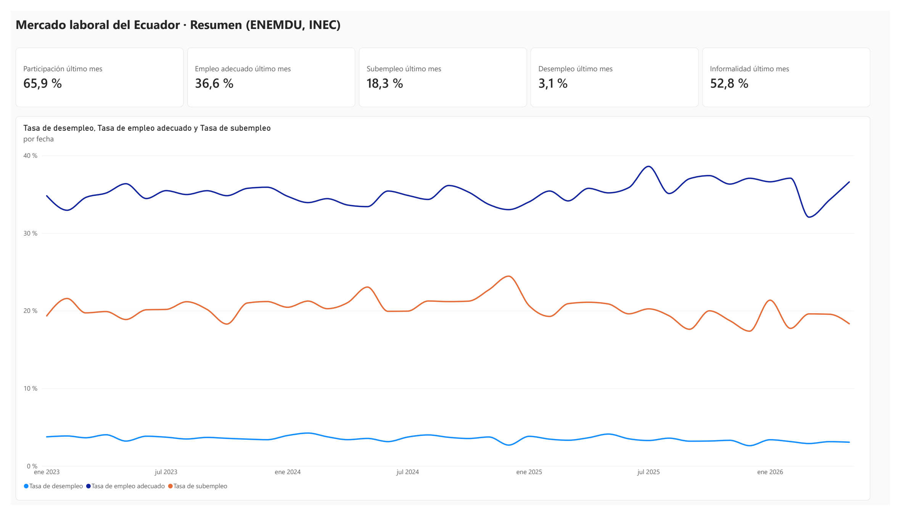
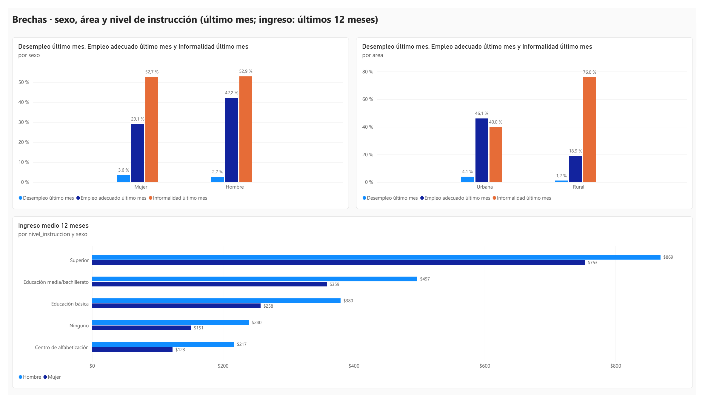
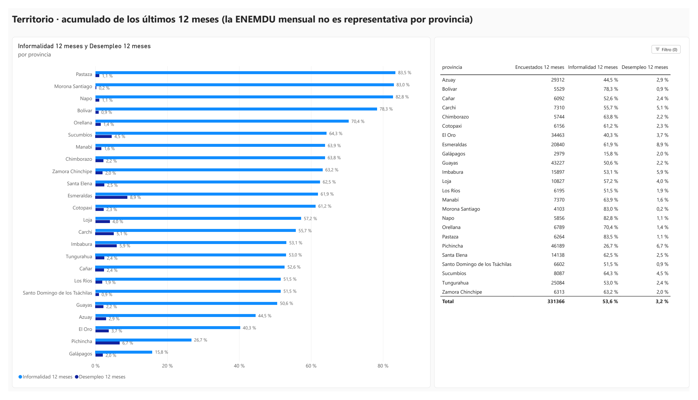
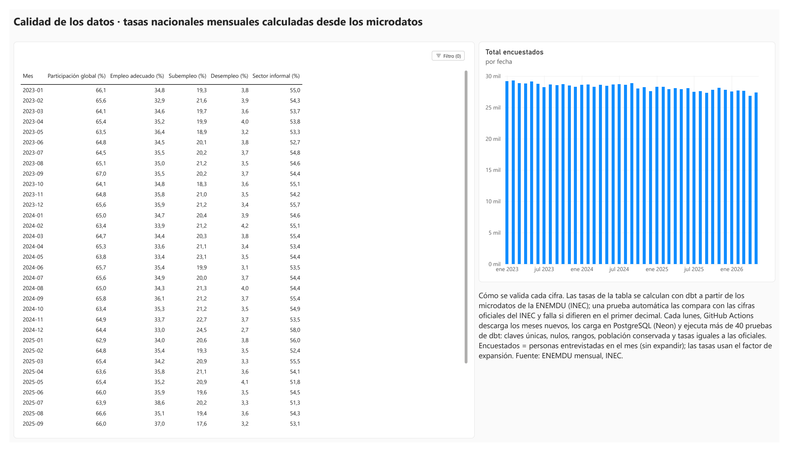

# BI · Power BI y Looker Studio

Los dos tableros leen de **`marts.bi_mercado_laboral`** (vista con etiquetas legibles) y de
**`marts.indicadores_nacionales`**, en Neon, con un **usuario de solo lectura** (`bi_lector`).

## Regla de oro: poblaciones, no tasas
La vista trae **poblaciones expandidas** (suma del factor de expansión). Las tasas se calculan siempre como
**suma ÷ suma** dentro de la herramienta. Nunca se promedian tasas: el promedio de tasas de provincias o meses da un
resultado incorrecto.

## Representatividad (importante)
La ENEMDU mensual es representativa **a nivel nacional**. Por provincia, un solo mes tiene muy pocos encuestados
(Morona Santiago: 297 en mayo de 2026), así que **las cifras provinciales se calculan acumulando 12 meses**
(unos 6.000 encuestados por provincia) y el tablero lo indica. Para sexo y área (urbana/rural) basta un mes.

## Medidas DAX (Power BI)

Tabla `bi_mercado_laboral` (importada desde PostgreSQL):

> Las medidas base se llaman `Total PEA`, `Total PET`, etc.: Power BI no permite que una medida se llame igual que
> una columna (`pea`, `pet`…), sin distinguir mayúsculas.

```dax
Total PEA = SUM ( bi_mercado_laboral[pea] )
Total PET = SUM ( bi_mercado_laboral[pet] )
Total empleo = SUM ( bi_mercado_laboral[empleo] )
Total encuestados = SUM ( bi_mercado_laboral[encuestados] )

Tasa de participación global = DIVIDE ( [Total PEA], [Total PET] )
Tasa de empleo adecuado = DIVIDE ( SUM ( bi_mercado_laboral[empleo_adecuado] ), [Total PEA] )
Tasa de subempleo = DIVIDE ( SUM ( bi_mercado_laboral[subempleo] ), [Total PEA] )
Tasa de desempleo = DIVIDE ( SUM ( bi_mercado_laboral[desempleo] ), [Total PEA] )
Tasa de informalidad = DIVIDE ( SUM ( bi_mercado_laboral[empleo_informal] ), [Total empleo] )
Ingreso laboral medio = DIVIDE ( SUM ( bi_mercado_laboral[ingreso_laboral_total] ),
                                 SUM ( bi_mercado_laboral[empleo_con_ingreso] ) )

-- Tarjetas del último mes (mismo patrón para Participación, Empleo adecuado, Subempleo e Informalidad)
Desempleo último mes =
    VAR fin = [Último periodo]
    RETURN CALCULATE ( [Tasa de desempleo], bi_mercado_laboral[fecha] = fin )

-- Último mes con datos y variación interanual (puntos porcentuales)
Último periodo = MAX ( bi_mercado_laboral[fecha] )
Desempleo hace un año =
    VAR fin = [Último periodo]
    RETURN CALCULATE ( [Tasa de desempleo], bi_mercado_laboral[fecha] = EDATE ( fin, -12 ) )
Variación interanual desempleo (pp) = ( [Desempleo último mes] - [Desempleo hace un año] ) * 100

-- Provincias: acumulado de los últimos 12 meses (representatividad)
Informalidad 12 meses =
    VAR fin = [Último periodo]
    RETURN CALCULATE ( [Tasa de informalidad],
        bi_mercado_laboral[fecha] > EDATE ( fin, -12 ), bi_mercado_laboral[fecha] <= fin )
Desempleo 12 meses =
    VAR fin = [Último periodo]
    RETURN CALCULATE ( [Tasa de desempleo],
        bi_mercado_laboral[fecha] > EDATE ( fin, -12 ), bi_mercado_laboral[fecha] <= fin )
-- Igual para "Ingreso medio 12 meses" (sobre [Ingreso laboral medio]) y "Encuestados 12 meses" (sobre [Total encuestados])
```

Formato: las tasas en **Porcentaje con 1 decimal** (como publica el INEC); el ingreso en **Moneda, 0 decimales**.

## Informe construido: `observatorio_laboral.pbix`

Abre el `.pbix` con Power BI Desktop (gratis). Al actualizar pedirá la contraseña de `bi_lector`: el archivo **no
guarda contraseñas**. También está exportado a [`observatorio_laboral.pdf`](observatorio_laboral.pdf).

| Página | Visuales |
|---|---|
| **1 · Resumen** | 5 tarjetas del último mes (participación, empleo adecuado, subempleo, desempleo, informalidad); líneas de desempleo, subempleo y empleo adecuado de enero de 2023 al último mes |
| **2 · Brechas** | Columnas por sexo y por área (desempleo, empleo adecuado, informalidad del último mes); ingreso medio de los últimos 12 meses por nivel de instrucción y sexo |
| **3 · Territorio** | Barras por provincia con informalidad y desempleo **acumulados 12 meses**; tabla con encuestados acumulados (de 2.979 en Galápagos a 46.189 en Pichincha); aviso de representatividad en el título |
| **4 · Calidad** | Tabla mensual de `indicadores_nacionales`; encuestados por mes; nota sobre la prueba contra las cifras oficiales del INEC y los tests de dbt del pipeline semanal |






Lo que se ve en los datos (último corte): informalidad del 52,8 % nacional, pero del 83 % en Pastaza, Morona
Santiago y Napo frente al 27 % en Pichincha; las mujeres tienen más desempleo y menos empleo adecuado que los
hombres; y el ingreso medio de un hombre con educación superior (869 USD) supera en 116 USD al de una mujer con el
mismo nivel (753 USD).

## Data Studio (antes Looker Studio) · versión pública en vivo

**👉 [Abrir el tablero público](https://datastudio.google.com/reporting/a932a4c2-ecc6-4148-afd1-df75157ebdb0)**
(no requiere cuenta; los datos se leen en vivo desde Neon).

Contenido: tarjetas de desempleo, empleo adecuado, subempleo, informalidad y participación; serie mensual
desde enero de 2023; filtros de periodo, sexo y área; nota de fuente y representatividad.

Cómo se conectó:
- Conector **PostgreSQL** de Google → host de Neon, puerto 5432, base `neondb`, usuario **`bi_lector`** (solo lectura).
- **SSL activado** con el certificado raíz público de Neon (*ISRG Root X1*, de Let's Encrypt). Data Studio exige subir
  el certificado del servidor cuando se activa SSL.
- **Consulta personalizada** `select … from marts.bi_mercado_laboral`: el selector de tablas del conector solo
  lista el esquema `public`, y `bi_lector` únicamente puede leer `marts`.
- Credenciales del propietario guardadas en la fuente: quien abre el enlace ve el tablero, pero no los datos de
  conexión.

Campos calculados (tipo **Porcentaje**; el ingreso en **USD**):

```
Tasa de desempleo            = SUM(desempleo) / SUM(pea)
Tasa de empleo adecuado      = SUM(empleo_adecuado) / SUM(pea)
Tasa de subempleo            = SUM(subempleo) / SUM(pea)
Tasa de informalidad         = SUM(empleo_informal) / SUM(empleo)
Tasa de participacion global = SUM(pea) / SUM(pet)
Ingreso laboral medio        = SUM(ingreso_laboral_total) / SUM(empleo_con_ingreso)
```

- *La fecha se usa como «Año-mes»*: con el tipo Fecha (día) la serie temporal dibujaba picos hasta cero entre meses.
- *«Access blocked: Error 400 invalid_scope»* al autorizar Data Studio desde el navegador integrado de una aplicación:
  Google solo concede ese permiso en navegadores normales (Chrome, Edge). Se hizo desde Chrome.
