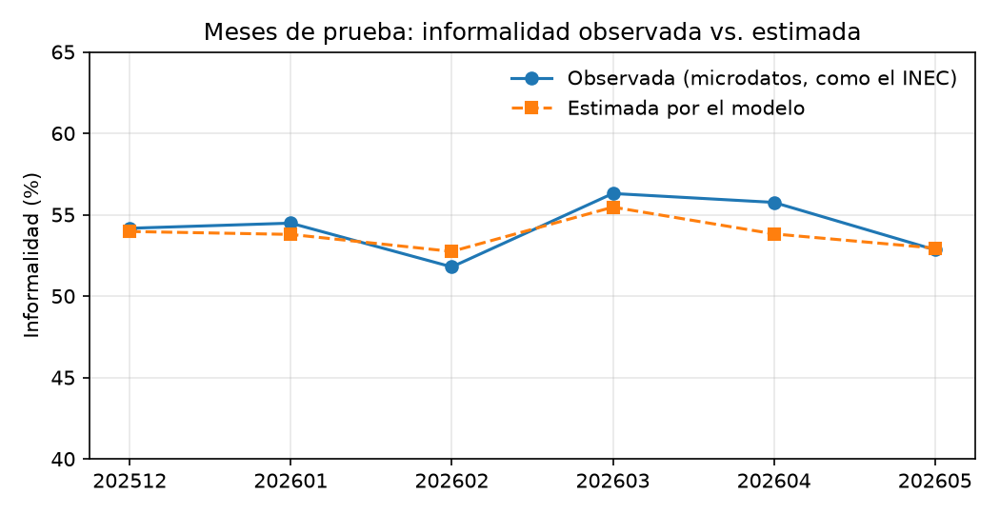
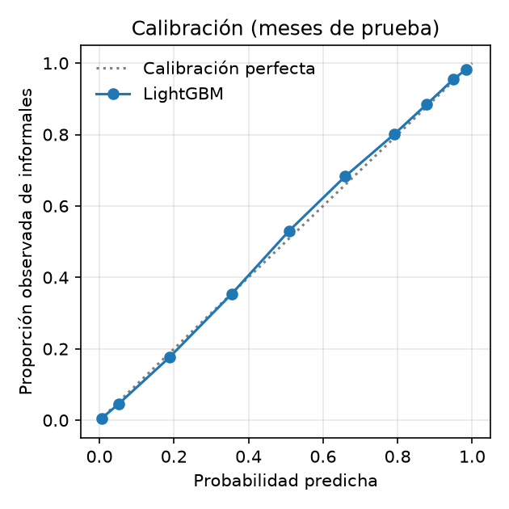
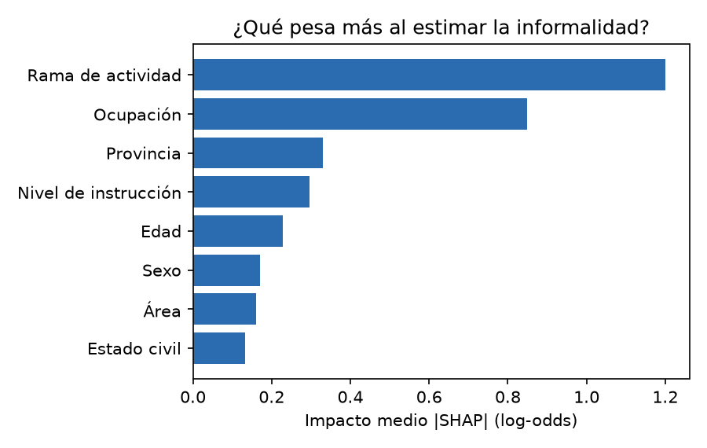
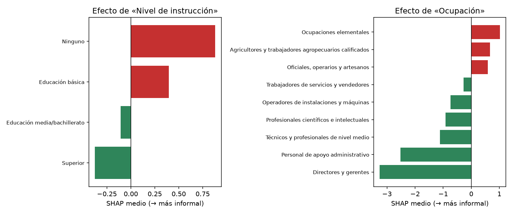
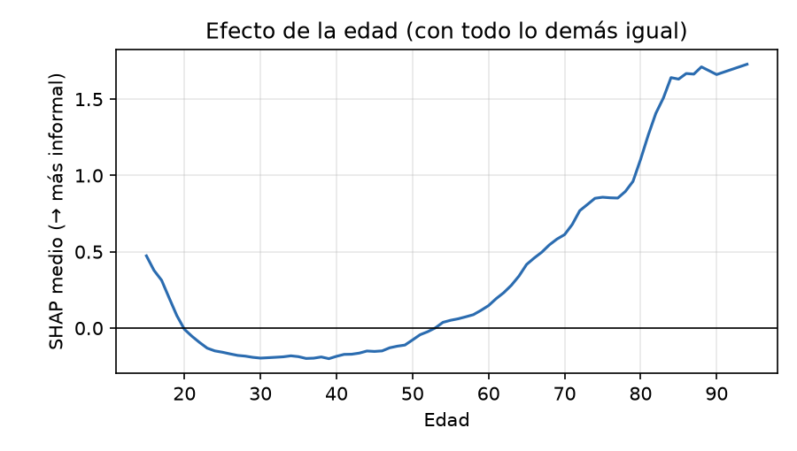

# Ficha del modelo · Probabilidad de informalidad laboral

> Fase 6 del observatorio. Código: [`modelo_informalidad.py`](../../src/observatorio/modelo_informalidad.py) ·
> entrenamiento: [`entrenar_informalidad.py`](../../scripts/entrenar_informalidad.py) ·
> decisiones: [ADR-0005](../../docs/adr/ADR-0005-modelo-informalidad.md).

## Qué hace
Estima la probabilidad de que una **persona ocupada** en Ecuador trabaje en el **sector informal**, a partir de su
edad, sexo, estado civil, nivel de instrucción, área, provincia, rama de actividad y ocupación. Usa la misma
definición que la tasa oficial del INEC (`secemp = 2` sobre los ocupados de 15 años o más).

## Datos
Microdatos mensuales de la **ENEMDU** (INEC), enero de 2023 a mayo de 2026: **559.089 personas ocupadas** en 41
meses. Validación **temporal**, sin mezclar meses:

| Conjunto | Meses | Filas | Uso |
|---|---|---|---|
| Entrenamiento | ene-2023 → may-2025 (29) | 398.378 | ajustar el modelo |
| Validación | jun-2025 → nov-2025 (6) | 80.872 | parada temprana (602 árboles) |
| **Prueba** | **dic-2025 → may-2026 (6)** | **79.839** | **evaluación final, una sola vez** |

## Resultados (meses de prueba, ponderados por el factor de expansión)

| Modelo | AUC-ROC | AUC-PR | Brier | Log loss |
|---|---|---|---|---|
| Sin modelo (tasa media) | 0,500 | 0,542 | 0,248 | 0,690 |
| Regresión logística | 0,881 | 0,889 | 0,139 | 0,429 |
| **LightGBM** | **0,910** | **0,918** | **0,120** | **0,375** |

**Bien calibrado**: la informalidad que estima el modelo para cada mes de prueba sigue a la observada (53,8 % frente
a 54,2 % en el conjunto; mayo de 2026: 52,95 % estimada, 52,84 % observada, 52,8 % publicada por el INEC).




## Qué aprendió el modelo (SHAP)


- **La rama de actividad y la ocupación pesan más que todo lo demás.** Agricultura, construcción, transporte y
  «otros servicios» empujan hacia la informalidad; la administración pública y las finanzas, hacia la formalidad.
- **La educación protege**: sin instrucción, la probabilidad sube con claridad; con educación superior, baja.
- **La edad tiene forma de U**: los menores de 20 y los mayores de 55 son más informales que quienes tienen entre 25
  y 45 años, con todo lo demás igual.
- **El área rural suma** a la informalidad incluso después de considerar la rama y la ocupación.




## Equidad (meses de prueba)

| Grupo | AUC | Informalidad observada | Estimada |
|---|---|---|---|
| Hombres | 0,897 | 54,9 % | 54,2 % |
| Mujeres | 0,927 | 53,2 % | 53,3 % |
| Urbana | 0,888 | 42,7 % | 42,3 % |
| Rural | 0,910 | 75,9 % | 75,4 % |

El modelo discrimina bien y está calibrado en todos los grupos (diferencias menores a 1 punto entre lo observado y lo
estimado). No funciona peor para mujeres ni para el área rural.

## Límites
- **No es causal**: SHAP muestra qué variables usa el modelo, no qué *causa* la informalidad.
- El **trabajo doméstico** remunerado tiene categoría propia en la ENEMDU (`secemp = 3`) y por definición no es
  «sector informal»; por eso «Hogares como empleadores» aparece con un efecto muy negativo.
- Las provincias con pocos encuestados al mes se apoyan en 41 meses de datos; aun así, sus efectos son menos
  precisos que los de las provincias grandes.
- Debe reentrenarse cuando cambie la estructura del mercado laboral; la Fase 10 vigilará la deriva.

## Reproducir
```powershell
pip install -r requirements-ml.txt
$env:PYTHONPATH = "src"; python scripts/entrenar_informalidad.py   # ~10 s; requiere la ingesta (Fase 2)
```
