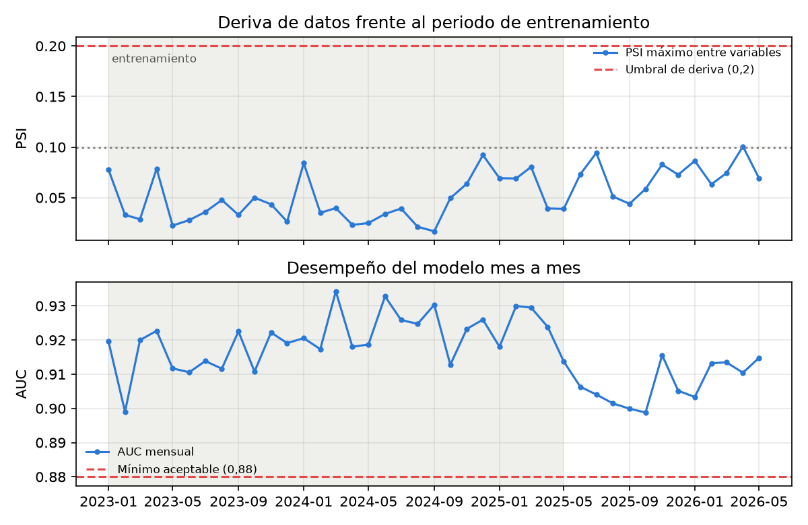

# Monitor de deriva del modelo de informalidad

> Fase 10. Código: [`monitoreo.py`](../../src/observatorio/monitoreo.py) ·
> ejecución: [`monitorear_deriva.py`](../../scripts/monitorear_deriva.py) ·
> decisiones: [ADR-0008](../../docs/adr/ADR-0008-monitoreo-deriva.md).

Cada lunes, después de cargar los meses nuevos, el pipeline compara cada mes con el periodo de entrenamiento y
publica el resultado en el resumen de GitHub Actions.

| Qué se mide | Cómo | Alerta |
|---|---|---|
| **Deriva de datos** | PSI de cada variable (edad por deciles) con proporciones ponderadas por el factor de expansión | 0,1–0,2 vigilar · > 0,2 deriva |
| **Discriminación** | AUC ponderado del mes | < 0,88 → reentrenar |
| **Calibración** | media móvil de 3 meses de (informalidad estimada − observada) | ≥ 1,5 puntos → reentrenar |

## Estado actual (modelo `lgbm-202605`)
- **Sin deriva** en los 12 meses posteriores al entrenamiento: PSI máximo entre 0,04 y 0,10.
- La variable que más se mueve es siempre la **provincia**: la muestra mensual no es representativa por provincia,
  así que su composición oscila de un mes a otro sin que cambie la población. Abril de 2026 llegó a 0,101
  («vigilar») y volvió a 0,069 en mayo.
- **AUC entre 0,90 y 0,92** fuera del entrenamiento, por encima del mínimo de 0,88.
- **Calibración**: abril de 2026 se desvió 1,9 puntos en un solo mes (55,8 % observado frente a 53,8 % estimado),
  pero marzo y mayo coinciden; la media de 3 meses queda por debajo del umbral. Por eso la regla usa la media
  móvil: un mes ruidoso no debe disparar un reentrenamiento.

Detalle por mes en [`deriva_mensual.csv`](deriva_mensual.csv) y resumen en [`resumen.json`](resumen.json).
