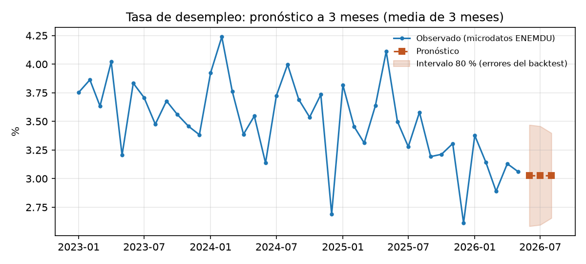
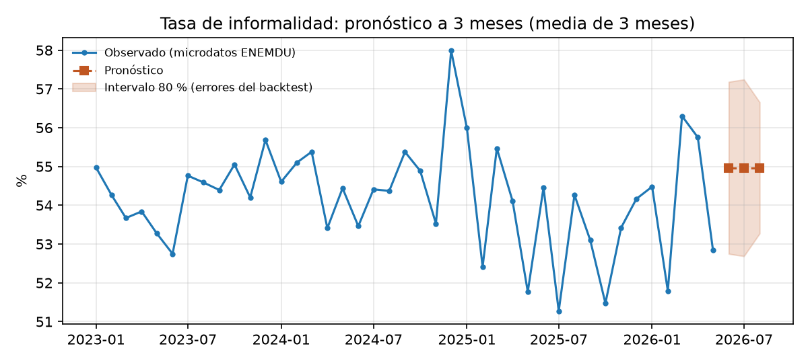

# Pronóstico a 3 meses · desempleo e informalidad

> Fase 7 del observatorio. Código: [`pronostico.py`](../../src/observatorio/pronostico.py) ·
> ejecución: [`pronosticar_indicadores.py`](../../scripts/pronosticar_indicadores.py) ·
> decisiones: [ADR-0006](../../docs/adr/ADR-0006-pronostico-desempleo.md).

## Cómo se evaluó
Serie mensual calculada desde los microdatos de la ENEMDU con la metodología oficial (41 meses, enero de 2023 a mayo
de 2026). **Backtesting con origen móvil**: 12 veces, el modelo ve solo los meses anteriores y pronostica 1, 2 y 3
meses adelante (pronósticos de abril de 2025 a mayo de 2026). Error medio absoluto (MAE) en **puntos porcentuales**.

## Resultados

| Modelo | Desempleo · MAE (pp) | Informalidad · MAE (pp) |
|---|---|---|
| **Media de los últimos 3 meses** | **0,242** | **1,392** |
| Último valor (referencia) | 0,326 | 1,835 |
| Suavizado exponencial | 0,336 | 1,488 |
| SARIMA(1,0,0)(1,0,0)₁₂ | 0,380 | 6,168 |
| Mismo mes del año anterior | 0,406 | 1,691 |

**Gana el modelo más simple**: promediar 3 meses reduce el error un **26 %** frente a repetir el último valor en el
desempleo, y un 24 % en la informalidad. Con 41 meses y una serie con mucho ruido muestral (de 2,69 % a 3,82 % entre
diciembre de 2024 y enero de 2025), suavizar ese ruido vale más que modelar estacionalidad. SARIMA, más complejo,
queda peor y en la informalidad es inestable: por eso se compara siempre contra referencias simples.

## Pronóstico (junio a agosto de 2026)

| Mes | Desempleo | Intervalo 80 % | Informalidad | Intervalo 80 % |
|---|---|---|---|---|
| jun-2026 | 3,03 % | 2,58 – 3,47 | 54,97 % | 52,75 – 57,18 |
| jul-2026 | 3,03 % | 2,60 – 3,46 | 54,97 % | 52,69 – 57,24 |
| ago-2026 | 3,03 % | 2,66 – 3,40 | 54,97 % | 53,27 – 56,66 |

Los intervalos son **empíricos**: el cuantil 80 % de los errores reales del backtest para cada horizonte. Con 12
errores por horizonte son orientativos.




## Comprobación futura
Cuando el INEC publique junio, julio y agosto de 2026, el pipeline semanal los descargará y bastará con volver a
ejecutar el script: el pronóstico de hoy quedará evaluado contra lo observado.

## Reproducir
```powershell
pip install -r requirements-ml.txt
$env:PYTHONPATH = "src"; python scripts/pronosticar_indicadores.py   # requiere la ingesta (Fase 2)
```
