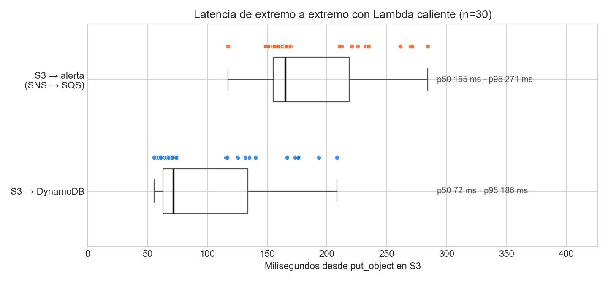
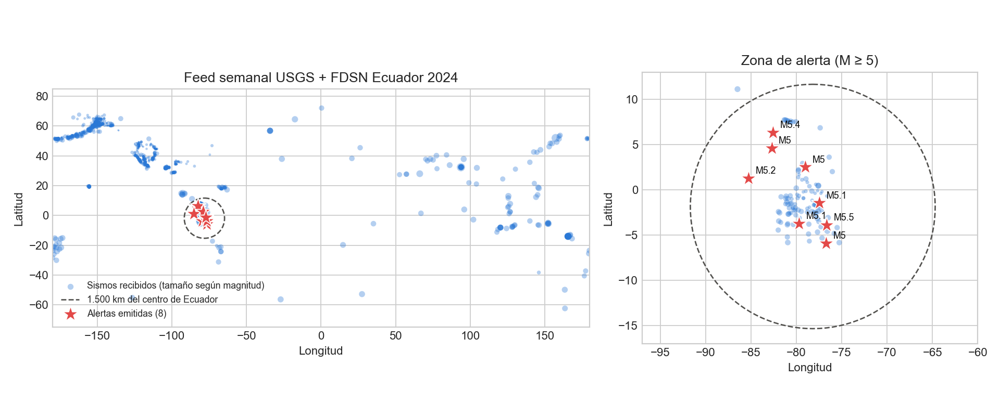

🇺🇸 **English (summary)** · 🇪🇸 [Español (full version)](README.es.md)

# 🌎 Serverless earthquake alerts · USGS → S3 → Lambda → DynamoDB → SNS

An event-driven pipeline that validates USGS GeoJSON, stores each earthquake only once and sends an alert for events of
magnitude **≥ 5** within **1,500 km** of the center of Ecuador. The AWS architecture is deployed with Terraform on
**LocalStack 4.8.1** in Docker; it needs no account, real credentials or cloud spending.

## Measured results (real integration on LocalStack)

Each file is uploaded to S3, the notification invokes the Lambda in its own container, which writes to DynamoDB and publishes
to SNS; an SQS queue subscribed to the topic receives the alerts. Real data: the `all_week` feed (2,080 earthquakes) and the
2024 FDSN query for Ecuador (100 earthquakes).

| Scenario | Received | Inserted | Duplicates avoided | Quarantined | Alerts in SQS |
|---|---:|---:|---:|---:|---:|
| Weekly feed, 1st delivery | 2,080 | 2,080 | 0 | 0 | 3 |
| Same file uploaded again | 2,080 | 0 | **2,080** | 0 | 0 |
| Ecuador 2024 with 5 injected errors | 100 | 95 | 0 | **5** | 5 |

| End-to-end latency (client clock) | n | p50 | p95 |
|---|---:|---:|---:|
| S3 → DynamoDB, warm Lambda | 30 | **72 ms** | **186 ms** |
| S3 → alert in SQS, warm Lambda | 30 | **165 ms** | **271 ms** |
| S3 → DynamoDB, cold start | 5 | 3,357 ms | 4,667 ms |
| S3 → alert in SQS, cold start | 5 | 3,458 ms | 4,645 ms |

- The conditional write (`attribute_not_exists`) absorbed the full repetition without a single duplicate or repeated alert.
- The batch of 2,080 events took **41.9 s** (≈ 50 events/s with one `PutItem` per event): the cost of writing one by one
  against an emulator; on AWS, `BatchWriteItem` or queue batches would be used.
- Invalid events do not block the batch: their detail goes to `cuarentena/` (quarantine).

**Architecture, real errors found by the integration, cost estimate on real AWS, limitations and reproduction commands:**
[full README (Spanish)](README.es.md). Commands are language-independent.
