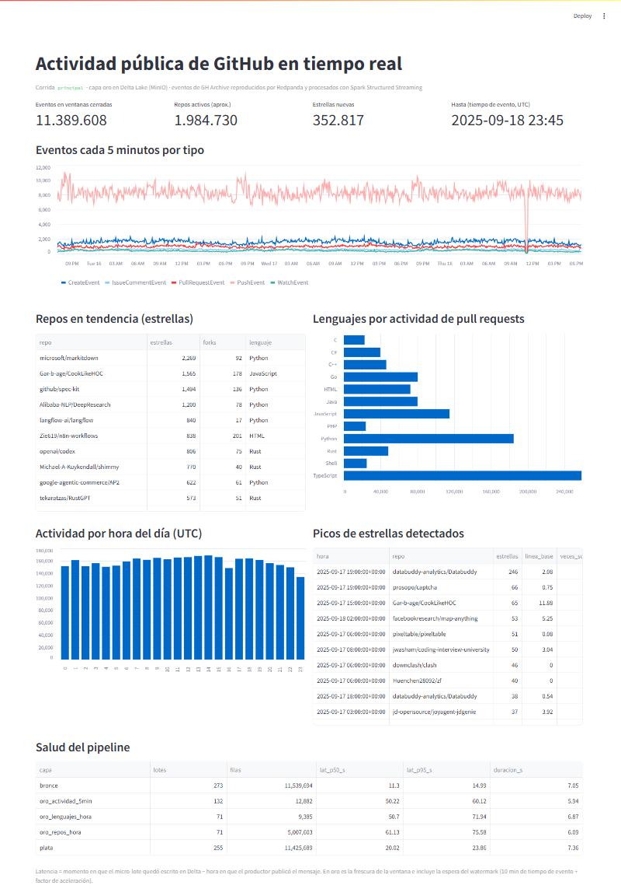

🇪🇸 [Español (full version)](README.md) · 🇬🇧 **English (summary)**

# Real-time streaming of GitHub activity · Redpanda + Spark Structured Streaming + Delta Lake

A 100% local streaming platform on Docker: **11.4 million public GitHub events** (GH Archive, 16–18 Sep 2025) are replayed
into **Redpanda** (Kafka) respecting their timestamps, and **Spark Structured Streaming** takes them through layers to
**Delta Lake tables on MinIO** (local S3): **bronze** (raw message) → **silver** (typed and deduplicated) → **gold**
(event-time window aggregates, trending repos, languages and spike detection). The pipeline is **exactly-once**: it was
`docker kill`ed mid-load and the counts match to the event.

| | |
|---|---|
| **Data** | GH Archive, 72 hours, 6.2 GB compressed, 11,425,689 events (15 types) |
| **Main run** | 3 days of GitHub replayed at **120x** in 36 min · 5,285 events/s sustained |
| **Latency (p50 / p95)** | bronze 11.6 / 20.5 s · silver 20.4 / 32.2 s, from publication in Redpanda to the write in Delta |
| **Exactly once** | 3 `docker kill` + 1 failure injected after writing a batch: **0 duplicates and 0 lost** in every layer |
| **Maximum throughput** | 20,801 events/s written to bronze with the producer at full speed |
| **Gold** | 5.03 million rows in 5 tables · 99 star spikes and 241 activity spikes detected in streaming |
| **Queries** | DuckDB directly on Delta in MinIO (7 SQL queries) + Streamlit dashboard |
| **Tests** | 27 tests (local Spark, real GH Archive sample) + CI in GitHub Actions |
| **Cloud** | Reference Terraform for MSK Serverless + EMR Serverless + S3 + Glue, **validated and not applied**; ≈ 60–900 USD/month depending on the scenario |

## Layers

| Layer | Table | Grain | What it demonstrates |
|---|---|---|---|
| bronze | `eventos` | one Kafka message | raw ingestion, replayable from offsets |
| silver | `eventos` | one typed GitHub event | explicit schema, validation, **deduplication by id with bounded state** |
| gold | `actividad_5min` | 5-min window × event type | event-time windows, **10-min watermark** |
| gold | `repos_hora` | 1-h window × repository | stars, forks, pushes, commits, PRs |
| gold | `lenguajes_hora` | 1-h window × language | language of each pull request's base repo |
| gold | `picos_actividad` | window with z ≥ 3 vs. the previous hour | analytics with history inside `foreachBatch` |
| gold | `picos_repos` | repo with ≥ 15 stars in 1 h and ≥ 5× its 24-h mean | detecting repos that take off |

**Architecture, decisions, all measurements, cost estimate and reproduction commands:** [full README (Spanish)](README.md).
Commands are language-independent.
